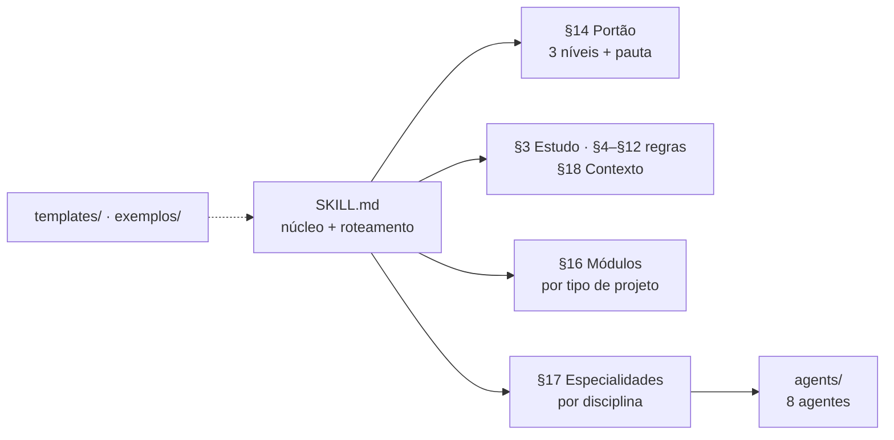

<div align="center">

# Método de Engenharia de Software

**Uma skill para agentes de IA e um guia para equipes: como se trabalha, como se decide e o que se considera entregue — em qualquer tipo de projeto.**

[](https://github.com/sergiojuniorreis/metodo-engenharia-software/actions/workflows/validar.yml)
[](LICENSE)
[](LICENSE-CODE)

*Regra sem teste é boato.*

</div>

---

## O que é

Um método para **todo projeto novo e todo reparo de código ou de arquitetura**, com ou sem IA:
backend, frontend, mobile, desktop, infraestrutura, dados, IA aplicada (RAG, agentes, MCP), ERP,
integrações, extensões de navegador, bibliotecas e CLIs.

Está escrito no formato **skill** (`SKILL.md` + `references/`), para ser carregado por um agente de
IA como o Claude Code. Também serve como guia de equipe: as regras são as mesmas para quem escreve
o código, seja gente ou modelo.

- **Estudo de abordagem antes do código**, com as quatro análises do escopo (paradigma de IA, rede
  neural, linear ou não linear, movimentos assíncronos).
- **Portão proporcional**: toda alteração passa por ele, em três níveis — trivial, padrão e alto
  risco —, com a pauta de segurança de 15 itens.
- **Escada de componentes**: comece simples, ache o gargalo, ponha o menor componente que o resolve.
- **Definição de pronto com evidência**, idempotência, memória com TTL, observabilidade, release e
  rollback.
- **Dados pessoais por classe e fronteira de confiança**: entrada de fora é hostil até prova em
  contrário.
- **Contexto sem desperdício**: o `AGENTS.md` do projeto vira um cache curto; o detalhe se lê só
  quando a tarefa pede.
- **Oito especialidades e oito agentes de desenvolvimento**: arquitetura, full stack, dados, IA
  aplicada, DevOps/SRE, cibersegurança, governança, qualidade e testes.

> De um projeto para outro muda o domínio, não o método.

### As oito regras de ouro

1. **Nenhum projeto começa pelo código**: começa pelo estudo de abordagem (§3).
2. **O núcleo roteia, o domínio decide, a IA só veta** em decisão com efeito financeiro, fiscal,
   legal ou cadastral.
3. **Regra sem teste é boato.**
4. **Nada é obrigatório por padrão**: comece simples, ache o gargalo, ponha o menor componente que
   o resolve e repita (§10).
5. **Operação que escreve é idempotente, com teto e freio.**
6. **Log completo, sem desistência silenciosa.**
7. **Segredo nunca cruza a fronteira; dado pessoal só ofuscado ou com finalidade e contrato
   escritos** (§11).
8. **Não invente número.** "Não medi" é resposta; número inventado é defeito.

---

## Instalar

Requer o [Claude Code](https://docs.anthropic.com/en/docs/claude-code) (ou outro agente que leia
skills no formato `SKILL.md`). A skill vai para `~/.claude/skills/`; os agentes são opcionais.

**Linux, macOS, Codespaces:**

```bash
git clone --depth 1 --branch v1.1.1 https://github.com/sergiojuniorreis/metodo-engenharia-software.git /tmp/mes
mkdir -p ~/.claude/skills/metodo-engenharia-software
cp -r /tmp/mes/SKILL.md /tmp/mes/PERFIL.modelo.md /tmp/mes/references /tmp/mes/agents \
      /tmp/mes/templates /tmp/mes/exemplos ~/.claude/skills/metodo-engenharia-software/
# Agentes, só no projeto que vai usá-los (rode na raiz do projeto):
mkdir -p .claude/agents && find /tmp/mes/agents -name '*.md' ! -name README.md -exec cp {} .claude/agents/ \;
rm -rf /tmp/mes
```

**Windows (PowerShell):**

```powershell
$tmp = Join-Path $env:TEMP 'mes'
git clone --depth 1 --branch v1.1.1 https://github.com/sergiojuniorreis/metodo-engenharia-software.git $tmp
$skill = Join-Path $HOME '.claude\skills\metodo-engenharia-software'
New-Item -ItemType Directory -Force $skill | Out-Null
Copy-Item -Recurse -Force "$tmp\SKILL.md", "$tmp\PERFIL.modelo.md", "$tmp\references", "$tmp\agents", "$tmp\templates", "$tmp\exemplos" $skill
# Agentes, só no projeto que vai usá-los (rode na raiz do projeto):
New-Item -ItemType Directory -Force '.claude\agents' | Out-Null
Get-ChildItem "$tmp\agents\*.md" -Exclude README.md | Copy-Item -Destination '.claude\agents' -Force
Remove-Item -Recurse -Force $tmp
```

Cada agente instalado põe a própria descrição no contexto de toda sessão: instale-os no projeto
que vai usá-los, não globalmente. A instalação usa a **versão marcada** (`--branch v1.1.1`), não a
ponta do `main`; para atualizar, troque pela versão mais recente em
[Releases](https://github.com/sergiojuniorreis/metodo-engenharia-software/releases) e repita.

**Outro agente com suporte a `SKILL.md`:** copie a mesma pasta para o diretório de skills que ele
lê. **Modelo sem suporte a skills:** cole o `SKILL.md` e as referências da situação no system
prompt — não no `AGENTS.md` do projeto, que é o cache curto do projeto (§18).

## Preparar um projeto

1. Copie [`templates/AGENTS.modelo.md`](templates/AGENTS.modelo.md) para a raiz do projeto como
   `AGENTS.md` e preencha: invariantes, comandos, mapa, armadilhas. Curto — entra em toda sessão.
2. Crie um `CLAUDE.md` com uma linha: `@AGENTS.md`.
3. *(Opcional)* Copie `PERFIL.modelo.md` para `PERFIL.md` na pasta da skill: idioma, shell, moeda,
   lei de dados, provedores de IA autorizados.
4. **Confira**: peça *"vou começar um projeto novo de integração com ERP"*. O agente deve responder
   pelo estudo de abordagem (§3) e pelo módulo §16.1 antes de propor código.

**Veja o fluxo inteiro num exemplo:** [`exemplos/exemplo-completo.md`](exemplos/exemplo-completo.md)
— uma mudança do pedido ao relatório da entrega, e o relatório curto de uma mudança trivial.

---

## Como funciona

O `SKILL.md` é o **núcleo**: regras de ouro, o portão resumido, as regras que valem sempre e a
tabela que diz qual arquivo carregar em cada situação. O resto entra **só quando a tarefa pede**.



### Módulos por tipo de projeto (§16)

| § | Arquivo | Quando |
|---|---|---|
| §16.1 | [`erp.md`](references/16-modulos/erp.md) | ERP e sistema transacional: documento fiscal, reprocessamento, cadastro mestre |
| §16.2 | [`orquestracao-mcp.md`](references/16-modulos/orquestracao-mcp.md) | Central de agentes, MCP, um manifesto por agente |
| §16.3 | [`apps-microsoft-google.md`](references/16-modulos/apps-microsoft-google.md) | Agente em e-mail, calendário, documentos |
| §16.4 | [`extensoes-navegador.md`](references/16-modulos/extensoes-navegador.md) | Extensão ou agente que opera o navegador |
| §16.5 | [`aplicativos.md`](references/16-modulos/aplicativos.md) | Mobile, desktop, API pública |
| §16.6 | [`front-end.md`](references/16-modulos/front-end.md) | Interface web: renderização, bundle, acessibilidade |
| §16.7 | [`infraestrutura.md`](references/16-modulos/infraestrutura.md) | Nuvem, rede, IaC, containers, acesso, custo |
| §16.8 | [`biblioteca-cli.md`](references/16-modulos/biblioteca-cli.md) | Biblioteca, SDK ou CLI publicados |

### Especialidades (§17)

| § | Arquivo | Quando |
|---|---|---|
| §17.1 | [`arquitetura.md`](references/17-especialidades/arquitetura.md) | Desenho, contratos, dados, microsserviços, várias linguagens |
| §17.2 | [`full-stack.md`](references/17-especialidades/full-stack.md) | Backend, API, banco |
| §17.3 | [`dados.md`](references/17-especialidades/dados.md) | Métrica, previsão, pipeline de dados |
| §17.4 | [`ia-aplicada.md`](references/17-especialidades/ia-aplicada.md) | LLM, RAG, busca semântica, agentes, avaliação |
| §17.5 | [`devops-sre.md`](references/17-especialidades/devops-sre.md) | CI/CD, deploy, SLO, incidente |
| §17.6 | [`ciberseguranca.md`](references/17-especialidades/ciberseguranca.md) | Ameaça, varredura, dependências |
| §17.7 | [`governanca.md`](references/17-especialidades/governanca.md) | ADR, dívida, LGPD, IA, evidência |
| §17.8 | [`qualidade-testes.md`](references/17-especialidades/qualidade-testes.md) | Que teste prova o quê, mutação, revisão |

### Agentes (`agents/`)

Oito especialistas para o Claude Code, cada um com frente, modelo e formato de saída próprios.
O padrão é zero agente: mudança trivial não aciona nenhum. Fluxo e devoluções em
[`agents/README.md`](agents/README.md).

<details>
<summary>Estrutura de arquivos</summary>

```
metodo-engenharia-software/
├── SKILL.md                     núcleo e roteamento
├── PERFIL.modelo.md             contexto opcional da equipe
├── references/                  §3–§18, carregados sob demanda
│   ├── 14-portao.md             portão em 3 níveis + resumo da pauta
│   ├── 14-6-pauta-seguranca.md  detalhe da pauta, por item
│   ├── 16-modulos/              por tipo de projeto
│   ├── 17-especialidades/       por disciplina
│   ├── 18-contexto-cache.md     cache de conhecimento do projeto
│   └── fontes.md                fontes externas
├── agents/                      8 agentes + fluxo
├── templates/                   AGENTS.md, ADR, relatório, questionário, manifesto de agente
├── exemplos/                    o fluxo inteiro num caso fictício
├── evals/                       cenários que provam o efeito da skill
├── scripts/validar.py · tests/  validação do repositório
└── CHANGELOG.md · CONTRIBUTING.md · SECURITY.md · LICENSE · LICENSE-CODE
```

</details>

---

## Prova

- **Validação estrutural**, a cada push: toda referência § e item da pauta existe, todo caminho
  citado existe, todo arquivo de `references/` está roteado, os agentes têm cabeçalho e modelo, e
  nenhum segredo entrou — na árvore e no histórico.

  ```bash
  python scripts/validar.py
  python -m unittest discover -s tests   # o validador reprova cada defeito plantado
  ```

  Requer só Python 3.

- **Evals**: 8 defeitos reais escritos por um agente que não leu o método, julgados por testes
  ocultos (48 execuções, com e sem a skill), e cenários de processo. Resultado honesto: na correção
  pontual de defeitos o modelo já acerta sozinho (24/24 sem a skill, 23/24 com); o ganho medido
  está no processo — em projeto novo, sem a skill o agente construiu às cegas, com ela fez o
  estudo de abordagem. Detalhe, custo e limitações em [`evals/README.md`](evals/README.md).

---

## Uso sem IA

| Momento | Leia | Produza |
|---|---|---|
| Início de projeto | §3 e §17.1 | Estudo de abordagem de meia página e os ADRs ([modelo](templates/adr.md)) |
| Antes de cada alteração | §14 | Nível, âncora e pauta respondida |
| Revisão de PR | §14.5 e §17.8 | Relatório da entrega ([modelo](templates/relatorio-entrega.md)) |
| "Posso entregar?" | §4 | Tabela de pronto com a evidência de cada linha |
| Release e incidente | §12 e §17.5 | Rollback registrado, incidente fechado com teste novo |

Comece pelo §14 (portão) e pelo §4 (pronto): são os que mais pegam defeito com menos esforço.

---

## Contribuir e relatar

- Contribuições: [`CONTRIBUTING.md`](CONTRIBUTING.md) — elas seguem o próprio método.
- Falha de segurança: [`SECURITY.md`](SECURITY.md) — relato privado, nunca issue pública.
- Conduta: [`CODE_OF_CONDUCT.md`](CODE_OF_CONDUCT.md).
- Mudanças por versão: [`CHANGELOG.md`](CHANGELOG.md).

## Autor e licença

Criado por **Sergio Volney dos Reis Junior** — [github.com/sergiojuniorreis](https://github.com/sergiojuniorreis).

- **Texto do método** (`SKILL.md`, `references/`, `agents/`, `templates/`, `exemplos/`, documentação):
  [CC BY 4.0](LICENSE) — use, adapte e redistribua, inclusive comercialmente, citando o autor e
  indicando se alterou.
- **Código** (`scripts/`, `tests/`, `evals/`, `.github/`): [MIT](LICENSE-CODE).

Sugestão de atribuição: *Método de Engenharia de Software*, de Sergio Volney dos Reis Junior
(github.com/sergiojuniorreis/metodo-engenharia-software), CC BY 4.0.
