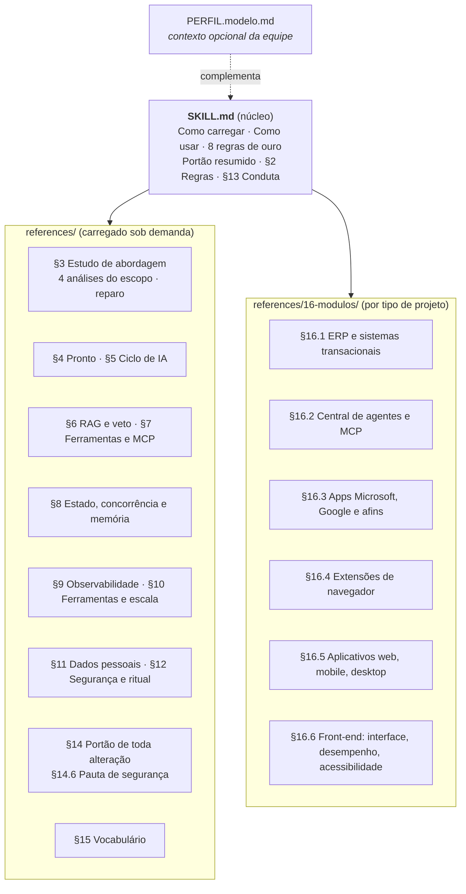

<div align="center">

# Método de Engenharia de Software

**Uma skill modular para agentes de IA e equipes de desenvolvimento: como se trabalha, como se decide e o que se considera entregue.**

[](LICENSE)
[](#)
[](SKILL.md)
[](#índice-dos-módulos)

*Regra sem teste é boato.*

</div>

---

## O que é

Um método de engenharia para **todo projeto novo e todo reparo de código ou de arquitetura**,
com ou sem IA: sistemas, ERPs, automações, aplicativos, integrações, centrais de agentes
(orquestração), agentes com MCP, agentes conectados a Microsoft 365 / Google Workspace e
extensões de navegador.

Ele foi escrito no formato **skill** (`SKILL.md` + `references/`), para ser carregado por um
agente de IA. Também funciona como guia para pessoas: as regras são as mesmas para quem
escreve o código, seja gente ou modelo.

O método cobre:

- **Estudo de abordagem antes do código**: oito perguntas, pre-mortem, modelagem de ameaça e
  as **quatro análises do escopo** (paradigma de IA, rede neural, linear ou não linear,
  movimentos assíncronos).
- **Definição de pronto com evidência**: cada dimensão tem a prova que a demonstra.
- **Idempotência, concorrência, memória com TTL, observabilidade, release e rollback.**
- **Ferramenta só por necessidade**: banco, fila e framework não entram por padrão.
- **Dados pessoais e fronteira de confiança**: entrada de fora é hostil até prova em contrário.
- **O portão do §14**: seis exigências para toda alteração de código, incluindo a pauta de
  segurança com 15 itens.

> De um projeto para outro muda o domínio, não o método.

### As oito regras de ouro

Se nada mais for lido, que se leia isto (do [`SKILL.md`](SKILL.md)):

1. **Nenhum projeto começa pelo código**: começa pelo estudo de abordagem (§3).
2. **O núcleo roteia, o domínio decide, a IA só veta**, em toda decisão com efeito
   financeiro, fiscal, legal ou cadastral.
3. **Regra sem teste é boato.**
4. **Nada é obrigatório por padrão**: nem banco, nem fila, nem framework (§10).
5. **Operação que escreve é idempotente, com teto e freio.**
6. **Log completo, sem desistência silenciosa.**
7. **Dado pessoal e segredo não cruzam fronteira sem ofuscação** (§11).
8. **Não invente número.** "Não medi" é resposta; número inventado é defeito.

---

## Mapa da skill

O `SKILL.md` é o **núcleo**: o agente sempre o lê inteiro. O resto fica em `references/` e só
é carregado quando a situação pede. Assim o contexto fica enxuto.



<details>
<summary>Estrutura de arquivos (texto)</summary>

```
metodo-engenharia-software/
├── SKILL.md                         ← núcleo: sempre lido inteiro
├── PERFIL.modelo.md                 ← modelo opcional de perfil da equipe/projeto
├── references/
│   ├── 03-estudo-de-abordagem.md
│   ├── 04-05-pronto-e-ciclo-ia.md
│   ├── 06-07-ia-ferramentas-mcp.md
│   ├── 08-estado-memoria.md
│   ├── 09-10-observabilidade-ferramentas.md
│   ├── 11-12-dados-seguranca-ritual.md
│   ├── 14-portao.md
│   ├── 15-vocabulario.md
│   └── 16-modulos/
│       ├── erp.md
│       ├── orquestracao-mcp.md
│       ├── apps-microsoft-google.md
│       ├── extensoes-navegador.md
│       ├── aplicativos.md
│       └── front-end.md
├── README.md
└── LICENSE
```

</details>

---

## Índice dos módulos

### Núcleo

| Arquivo | Conteúdo |
|---|---|
| [`SKILL.md`](SKILL.md) | Como carregar, tabela "situação → seção", as oito regras de ouro, o portão resumido, **§2 Regras que valem sempre** (julgamento, arquitetura, anti-desculpas, sinais de alerta) e **§13 Conduta de trabalho** com o dono do projeto |
| [`PERFIL.modelo.md`](PERFIL.modelo.md) | Modelo opcional. Idioma, shell, moeda, lei de dados, cofre de segredos, linhas de trabalho e regras do domínio ficam aqui, nunca no núcleo |

### Referências (`references/`)

| § | Arquivo | Quando carregar | Destaques |
|---|---|---|---|
| §3 | [`03-estudo-de-abordagem.md`](references/03-estudo-de-abordagem.md) | Projeto novo, mudança de rumo, reparo de arquitetura | As oito perguntas · conduta sênior (pre-mortem, STRIDE, funções de aptidão) · **as quatro análises do escopo** · da forma do problema à linguagem · reparo (cerca de Chesterton, teste de caracterização, figueira estranguladora) · fontes externas |
| §4 · §5 | [`04-05-pronto-e-ciclo-ia.md`](references/04-05-pronto-e-ciclo-ia.md) | "Está pronto para entregar?" · construir skill, agente ou RAG | Tabela "pronto quando × evidência que prova" · ciclo de IA em 13 passos · qualidade de toda entrega |
| §6 · §7 | [`06-07-ia-ferramentas-mcp.md`](references/06-07-ia-ferramentas-mcp.md) | RAG, prompt de decisão, ferramenta/MCP, automação que grava em sistema alheio | Fonte primária manda · schema antes da regra · citação literal conferida · uma ferramenta = um verbo · circuit breaker · raio de explosão e freio · provar o fallback |
| §8 | [`08-estado-memoria.md`](references/08-estado-memoria.md) | Dado compartilhado, retomada, cache, memória do sistema | Escrita condicional · máquina de estados explícita · cinco cortes de retomada · memória com origem, versão da regra, TTL e lápide |
| §9 · §10 | [`09-10-observabilidade-ferramentas.md`](references/09-10-observabilidade-ferramentas.md) | Log, métrica, alerta, custo · vai entrar banco, fila, container | Identificador por execução · custo como métrica · tabela "entra quando × não entra, use isto" · dimensionamento e escala por gatilho medido |
| §11 · §12 | [`11-12-dados-seguranca-ritual.md`](references/11-12-dados-seguranca-ritual.md) | Dado pessoal, documento de cliente, entrada de fora · produção, release, incidente | Minimização · ofuscação antes do modelo · entrada hostil (inclusive a saída do modelo) · ritual de mudança |
| §14 | [`14-portao.md`](references/14-portao.md) | **Toda alteração de código, antes da primeira edição** | Auditoria total (mapa de impacto + diff hunk a hunk) · âncora contra drift · ferramenta nova · agentes com orçamento · relatório da entrega · **pauta de segurança (15 itens)** |
| §15 | [`15-vocabulario.md`](references/15-vocabulario.md) | Dúvida sobre um termo | Núcleo, skill, setor, corpus, bateria, veto, lápide, ADR, drift, outbox, saga, entre outros |

### Módulos por tipo de projeto (`references/16-modulos/`)

| § | Arquivo | Carregue quando |
|---|---|---|
| §16.1 | [`erp.md`](references/16-modulos/erp.md) | O projeto customiza, integra ou automatiza um ERP ou outro sistema transacional (financeiro, fiscal, estoque, pedidos) |
| §16.2 | [`orquestracao-mcp.md`](references/16-modulos/orquestracao-mcp.md) | O produto tem vários agentes coordenados, um orquestrador, ou cria/consome servidores MCP |
| §16.3 | [`apps-microsoft-google.md`](references/16-modulos/apps-microsoft-google.md) | O agente lê ou escreve em e-mail, calendário, documentos, chat ou arquivos de uma suíte de escritório |
| §16.4 | [`extensoes-navegador.md`](references/16-modulos/extensoes-navegador.md) | O projeto é uma extensão, um userscript ou um agente que navega e clica |
| §16.5 | [`aplicativos.md`](references/16-modulos/aplicativos.md) | O projeto tem interface para usuário final ou API pública |
| §16.6 | [`front-end.md`](references/16-modulos/front-end.md) | O projeto tem interface web: renderização, orçamento de bundle, Core Web Vitals, arquitetura de componentes, acessibilidade e a stack de referência |

> **Projeto sem IA:** §5, §6, as análises A e B do §3 e os módulos §16.2 a §16.4 se respondem
> "não se aplica — motivo". O resto vale inteiro.

---

## Como usar

Escolha o cenário. Nos três, a pasta precisa manter a estrutura acima, porque o `SKILL.md`
aponta para `references/` por caminho relativo.

### 1. Como skill no Abacus.AI (DeepAgent) ou em outro agente com suporte a skills

O agente lê o nome e a descrição do `SKILL.md` para decidir quando usar a skill. Depois lê o
núcleo inteiro e só abre as referências que a tarefa pede.

**Passo a passo:**

1. Baixe o repositório:
   ```bash
   git clone https://github.com/sergiojuniorreis/metodo-engenharia-software.git
   ```
2. Copie **apenas** os arquivos da skill para a pasta de skills do agente, numa pasta com o
   mesmo nome do campo `name` do `SKILL.md`:
   ```bash
   mkdir -p skills/metodo-engenharia-software
   cp -r metodo-engenharia-software/SKILL.md \
         metodo-engenharia-software/PERFIL.modelo.md \
         metodo-engenharia-software/references \
         skills/metodo-engenharia-software/
   ```
   O `README.md` e a `LICENSE` servem para o repositório e não precisam ir para a pasta da skill.
3. **No Abacus.AI / DeepAgent:** envie os arquivos na conversa (ou informe a URL deste
   repositório) e peça *"crie uma skill chamada `metodo-engenharia-software` a partir destes
   arquivos, usando a descrição do frontmatter do `SKILL.md`"*. O agente registra a skill e
   ela passa a valer nas próximas conversas.
4. **Em outros agentes compatíveis com o formato `SKILL.md`:** coloque a pasta no diretório
   de skills que o agente lê (por exemplo, `~/.claude/skills/` no Claude Code).
5. *(Opcional)* Copie `PERFIL.modelo.md` para `PERFIL.md` dentro da pasta da skill e preencha
   idioma, shell, moeda, lei de dados e regras do seu domínio.

#### Instalação por terminal (Linux, Claude Code, Codespaces)

No **Claude Code** (local no Linux) ou em um **GitHub Codespaces**, cole o comando abaixo no
terminal. Ele clona o repositório e instala só os arquivos da skill em `~/.claude/skills/`, na
pasta com o nome do campo `name` do `SKILL.md`:

```bash
# 1. Clona num diretório temporário e instala a skill no Claude Code
git clone --depth 1 https://github.com/sergiojuniorreis/metodo-engenharia-software.git /tmp/mes \
  && mkdir -p ~/.claude/skills/metodo-engenharia-software \
  && cp -r /tmp/mes/SKILL.md /tmp/mes/PERFIL.modelo.md /tmp/mes/references \
        ~/.claude/skills/metodo-engenharia-software/ \
  && rm -rf /tmp/mes \
  && echo "Skill instalada em ~/.claude/skills/metodo-engenharia-software"
```

> **Codespaces:** o diretório `~/.claude/skills/` é lido pelo Claude Code dentro do Codespace.
> Se o seu agente usa outro caminho (por exemplo um diretório `skills/` na raiz do projeto),
> troque o destino `~/.claude/skills/metodo-engenharia-software` pelo caminho que ele lê.

**Conferir a instalação:**

```bash
ls ~/.claude/skills/metodo-engenharia-software
# deve listar: PERFIL.modelo.md  references  SKILL.md
```

**Atualizar depois** (repetir o mesmo comando sobrescreve com a versão mais recente) ou, se
preferir manter um clone versionado:

```bash
git clone https://github.com/sergiojuniorreis/metodo-engenharia-software.git
cd metodo-engenharia-software && git pull   # nas próximas vezes
```

**Como conferir que funcionou:** peça ao agente *"vou começar um projeto novo de integração
com ERP"*. Uma skill carregada responde pelo **estudo de abordagem (§3)** e pelo **módulo
§16.1** antes de propor qualquer código. Se ele for direto para o código, a skill não
disparou.

### 2. Como system prompt concatenado (LLMs sem suporte a pastas)

Para modelos que só aceitam texto (API de chat, `AGENTS.md`, arquivo de regras do editor,
GPT personalizado), junte o núcleo com as referências da situação num único arquivo.

**Prompt completo** (todas as seções):

```bash
cd metodo-engenharia-software
{ cat SKILL.md; for f in references/*.md references/16-modulos/*.md; do
    printf '\n\n---\n\n<!-- %s -->\n\n' "$f"; cat "$f"; done; } > prompt-completo.md
```

**Prompt enxuto** (núcleo + o que o projeto usa). Exemplo para um projeto de agente com MCP:

```bash
cat SKILL.md references/14-portao.md references/03-estudo-de-abordagem.md \
    references/06-07-ia-ferramentas-mcp.md references/16-modulos/orquestracao-mcp.md \
    > prompt-agente-mcp.md
```

**PowerShell (Windows):**

```powershell
Set-Location metodo-engenharia-software
$arquivos = @('SKILL.md') + (Get-ChildItem references\*.md, references\16-modulos\*.md).FullName
Get-Content $arquivos -Encoding UTF8 | Set-Content prompt-completo.md -Encoding UTF8
```

Depois cole o arquivo gerado no campo de system prompt ou salve como `AGENTS.md` (ou o
equivalente da sua ferramenta) na raiz do projeto.

**Regras para escolher o que concatenar:**

- O `SKILL.md` vai **sempre**.
- O **§14 (`14-portao.md`)** vai sempre que o modelo for alterar código.
- Inclua os módulos do §16 que correspondem ao tipo de projeto.
- Prompt longo custa token em toda chamada. Se a janela ou o orçamento apertarem, use a
  versão enxuta.

### 3. Como referência metodológica (sem IA)

O método também funciona como guia de equipe, checklist de revisão e base de onboarding.

| Momento | O que ler | O que produzir |
|---|---|---|
| Kickoff de projeto | §3 inteiro | Estudo de abordagem de meia página com as quatro análises e os ADRs da stack |
| Antes de cada alteração | §14.1, §14.2 e §14.6 | Mapa de impacto, âncora (objetivo, aceite, escopo, invariantes, Fora) e pauta de segurança respondida |
| Revisão de PR | §14.5 e "Sinais de alerta" do §2 | Relatório da entrega com evidência por item |
| "Posso entregar?" | §4 | Tabela de pronto preenchida, com a evidência ao lado de cada linha |
| Incidente ou release | §12 | Ritual de mudança, release arquivada com rollback registrado e incidente fechado com teste novo |
| Onboarding | `SKILL.md` + §15 | Vocabulário comum da equipe |

**Sugestão:** adote o método por partes. Comece pelo §14 (portão) e pelo §4 (pronto). São os
que mais pegam defeito com menos esforço.

---

## Adaptando ao seu contexto

- **Regra do repositório vence a do método.** Se o seu projeto tem convenção própria, ela
  prevalece, e a divergência deve ser dita em voz alta, não resolvida no silêncio.
- **Contexto vai no `PERFIL.md`, não no núcleo.** Palavras de domínio, idioma, moeda e lei de
  dados (LGPD, GDPR ou outra) ficam no perfil. Assim o núcleo continua genérico e pode ser
  atualizado sem conflito.
- **Projeto sem IA** responde as seções de IA com "não se aplica — motivo". Fora isso, o
  método vale inteiro.

---

## Contribuindo

Contribuições são bem-vindas, com uma condição: **elas seguem o próprio método.**

1. **Abra uma issue antes do PR** descrevendo o problema: o que a regra atual deixa passar, ou
   onde ela atrapalha, com um caso real (mascarado, sem dado pessoal nem de cliente).
2. **Uma mudança por PR**, dentro de um único arquivo ou seção sempre que possível
   (*setores nomeados*, §2).
3. **Regra nova vem com o motivo e a evidência:** o caso que ela teria pego, a fonte que a
   sustenta ou o teste que a comprova. *Regra sem teste é boato.*
4. **Não quebre a estrutura:** o `SKILL.md` continua sendo o núcleo, o detalhe vai para
   `references/` e a tabela "Como carregar" é atualizada no mesmo commit.
5. **Zero palavra de domínio no núcleo.** Regra específica de um setor ou tipo de projeto vai
   para um módulo do §16 ou para o `PERFIL.modelo.md`.
6. **Português do Brasil**, tom direto, sem jargão desnecessário.

---

## Licença

Distribuído sob a licença **MIT**. Veja [`LICENSE`](LICENSE).

> Por se tratar de um texto metodológico, a licença
> [CC BY 4.0](https://creativecommons.org/licenses/by/4.0/deed.pt_BR) é uma alternativa válida
> caso se queira exigir atribuição explícita em obras derivadas. A troca é decisão do mantenedor.

---

<div align="center">

**Se este método evitou um defeito em produção, deixe uma ⭐ no repositório.**

</div>
